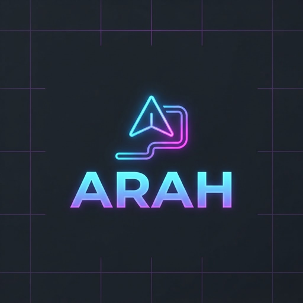
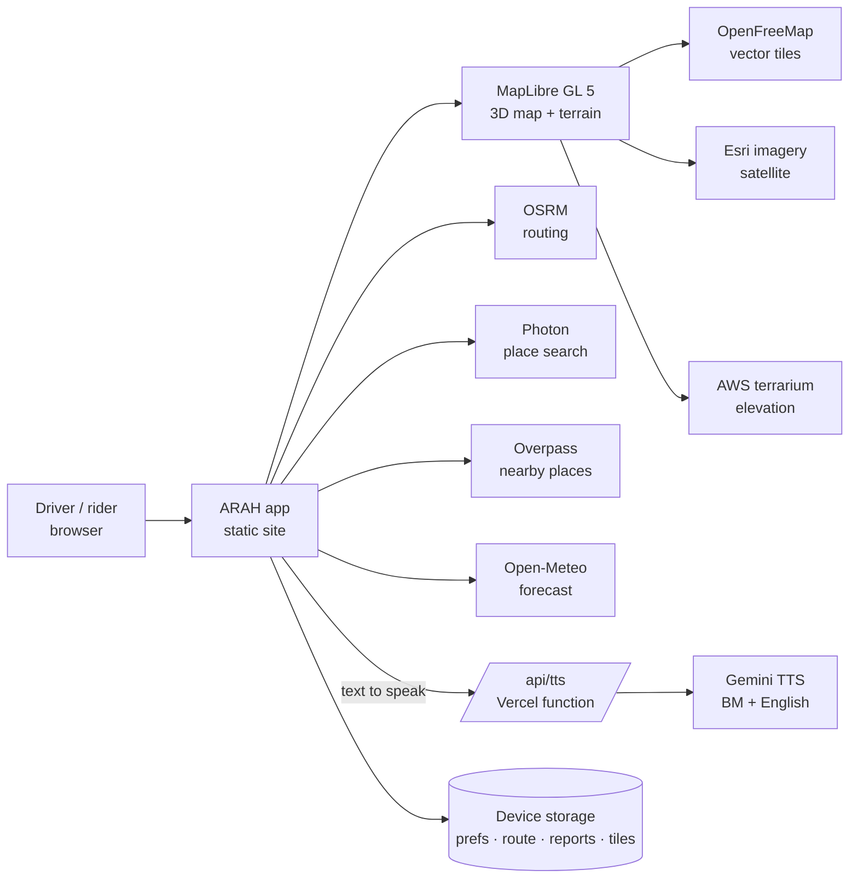
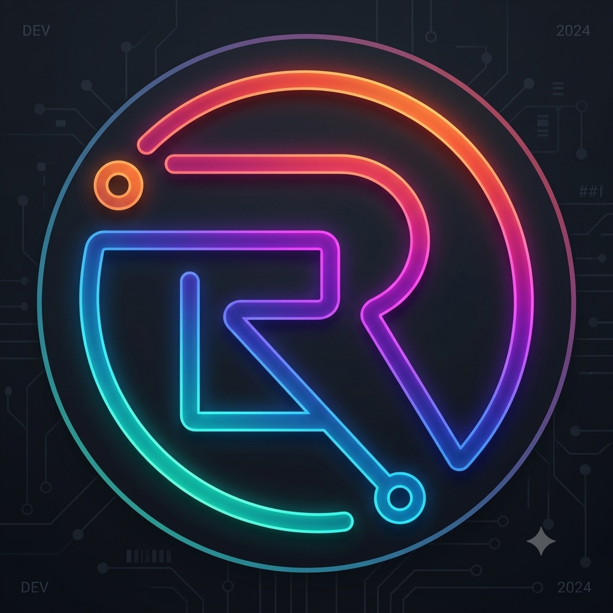

<div align="center">





**A free 3D low-poly navigation map for Malaysian roads, with turn-by-turn voice in Bahasa Malaysia, English, 中文 and தமிழ்.**


</div>

## What is ARAH?

**ARAH** (Malay for *direction*) is a web-based navigation app built for the way Malaysians drive and ride. It draws the country as a 3D low-poly map with recognisable landmarks, finds routes with toll estimates in **RM**, searches for **surau, R&R, EV chargers, fuel and food** along the way, and speaks every instruction in your own language.

It is a **100% non-profit beta** by **Rydetech Global Enterprise**: free, no ads, no accounts, no tracking. Your location and the reports you file stay on your device.

> **Beta release.** Always follow road signs and local traffic laws. ARAH's route times and toll figures are estimates.

<div align="center">

</div>

---

## Features

### 🗺️ Four map looks

| Mode | Malay · English | What you get |
| --- | --- | --- |
| Night | **Malam** · Neon night | The signature look: a dark circuit-board ground lit by a cyan route line |
| Day | **Siang** · Daylight | Bright map with a blue route line and white casing |
| Satellite | **Satelit** · Satellite + labels | Esri World Imagery with place labels |
| Terrain | **Rupa bumi** · 3D terrain | Real elevation (×1.4 exaggeration) so highlands and Gunung Kinabalu stand up |

An **Auto siang / malam** option switches between day and night for you. On the map: toggle 3D, reset north, jump to **my location**, change map views, or file a report.

### 🏙️ 3D low-poly landmarks

Twelve low-poly landmarks you can tap for a short spoken guide, height and city:

Menara Berkembar Petronas · Merdeka 118 · Menara Kuala Lumpur · Masjid Negara · Bangunan Sultan Abdul Samad · Batu Caves · Masjid Putra · Komtar · Menara Alor Setar · A Famosa · Bangunan DUN Sarawak · Gunung Kinabalu

Each one is a **textured low-poly 3D model** with its real proportions and materials: the Petronas steel-and-glass star towers with the skybridge, Merdeka 118's twisting crystal shaft, Menara KL's fluted shaft and glass pod, Masjid Negara's 18-point turquoise folded roof, Sultan Abdul Samad's striped brickwork with arched windows and green domes, Batu Caves' limestone hill with the golden Lord Murugan and rainbow steps, Masjid Putra's rose dome, Komtar, Menara Alor Setar, the A Famosa laterite gate, the golden payung roof of DUN Sarawak and a faceted Gunung Kinabalu. Windows light up after dark. The models and their textures are **original work drawn in code** (`assets/landmarks/`), so there are no third-party licences to track and no image downloads. They are drawn in the map's own WebGL context, so towers, terrain and buildings hide each other correctly. The 3D engine (three.js, vendored, integrity-pinned: `npm run landmarks:build`) is fetched only when the map first looks at a landmark, and skipped on Data Saver or without WebGL, in which case the earlier flat shapes stay. Tapping a landmark still opens its guide. Switch off with `__arahLandmark3d.set(false)`. To use a real scanned model for one landmark later, add a licensed `.glb` and a loader for it without touching the rest.

Start from one of **nine cities**: Kuala Lumpur, George Town, Melaka, Putrajaya, Johor Bahru, Ipoh, Kota Kinabalu, Kuching and Langkawi.

### 🧭 Routing that fits Malaysia

- **Search** places with *Cari tempat · Search Malaysia*, set a start (*Titik mula*) and destination (*Destinasi*), and swap them with one tap.
- **Alternative routes** with distance, time and **toll estimates in RM**.
- **Elak tol** (avoid tolls) and **Elak lebuh raya** (avoid highways) switches.
- **Depart time** (*Bertolak · Depart*): arrival estimates adjust for time-of-day congestion in Malaysia time and for forecast rain, weighted by how urban the route is.
- **Save your route** and reload it later, even with no signal.

### 🔊 Voice guidance in four languages

| Language | Guide voice | Sample |
| --- | --- | --- |
| Bahasa Malaysia | Gemini voice via `/api/tts`, speaks the sentence as written | “Belok kiri di hadapan.” |
| English | Gemini voice via `/api/tts`, speaks the sentence as written | “Turn left ahead.” |
| 中文 | Your device's voice | “前方左转。” |
| தமிழ் | Your device's voice | “முன்னால் இடதுபுறம் திரும்புங்கள்.” |

Next-step previews read *Kemudian · Then · 然后 · பிறகு*. Landmark and place guides speak in the language you pick, and a **Dengar panduan · Listen to guide** button replays it.

### 🎥 AR driver assist (Beta)

Turn on **AR** (top-left of the map) and one small window appears while you navigate: the live camera view with detection boxes, and all the readings and alerts written over it. The AI (**YOLOX-nano**, running on your phone's **WebGL** in a background worker, so the map stays smooth) works entirely on the device. No video is uploaded, recorded or saved.

| Reads | How |
| --- | --- |
| **Hazards** | Cars, buses, trucks, motorcycles, pedestrians, cyclists, animals, traffic lights (red/amber/green) and stop signs |
| **Distance** | Estimated from apparent size, to the vehicle in your lane |
| **Following gap** | Seconds behind the lead vehicle (the two-second rule) and time-to-collision from how fast the gap closes |
| **Speed** | Your speed from GPS, and the lead vehicle's approximate speed |
| **Lane** | Position in the lane, drift warning and lane-change detection (lane lines found with image processing) |

Alerts appear at the top of the window in Bahasa Malaysia, English, 中文 or தமிழ், with a short beep and vibration for danger. The window can be dragged and enlarged. The camera stops when you close AR, and AR that started with a trip stops when the trip ends.

> **Assistance only.** Estimates come from one phone camera (about ±25%) and need a phone mounted level in a holder with a clear view of the road. Never hold the phone while driving. The model sees common road users, not potholes, debris or flooding; those need a custom-trained model (see `assets/ar/models/MODEL.md`).

### 📍 Along-the-route search

Eight groups, powered by OpenStreetMap through Overpass:

| Group | Finds |
| --- | --- |
| **Tarikan** | Attractions, museums, viewpoints, theme parks, zoos |
| **Minyak** | Fuel stations |
| **EV** | Charging stations |
| **Surau / Masjid** | Muslim prayer places |
| **R&R** | Highway rest areas and services |
| **Makan** | Restaurants, food courts, fast food |
| **Tandas** | Toilets |
| **Parkir** | Parking |

### ⚠️ Community road reports

File a report from the map and ARAH announces it when it is within 500 m ahead (*Di hadapan*). Each type fades out when it is likely to be stale.

| Report | Malay · English | Stays for |
| --- | --- | --- |
| 🚗 | **Kesesakan** · Traffic jam | 3 h |
| 💥 | **Kemalangan** · Accident | 3 h |
| 🌊 | **Banjir kilat** · Flash flood | 8 h |
| 🚧 | **Kerja jalan** · Roadworks | 72 h |
| 🕳️ | **Jalan berlubang** · Pothole / debris | 48 h |
| 🚓 | **Sekatan polis** · Police block | 3 h |
| ⛔ | **Sekatan jalan raya** · Roadblock / road closed | 12 h |
| ⛰️ | **Tanah runtuh** · Landslide | 72 h |
| ☂️ | **Tempat berteduh** · Rider rain shelter | stays |

Reports are stored on your device only. The sample reports shown on first launch are labelled *sample*.

### 🌦️ Weather and rain awareness

Forecast rain from **Open-Meteo** nudges arrival estimates up when it is heavy, and a weather line shows conditions for your trip.

### 🍔 Makan & Mall (Beta)

A directory of **39 Malaysian fast-food and cafe chains and 48 shopping malls**, each with its logo. Tap a brand to find its outlets around the map, or tap *All nearby* for anything not on the list. Outlets are found live from OpenStreetMap, so results are only as complete as the map data, and a missing chain can still show up under *All nearby*. Results appear as logo markers on the map, and *Find route* hands the place to the normal search and routing. The button is hidden during a trip.

Logos load from each brand's own website, only for the tiles you scroll to, with no referrer sent. If a logo cannot be loaded, or you are offline, a coloured initials badge is shown. Untick *Logos from brand sites* in the sheet to make no requests to brand sites. Logos are trademarks of their owners and are not stored or redistributed by this repository.

### ⏳ Loading screen

A branded 3D loader paints on the very first frame (inline in the page shell, no files to fetch): a neon road rushing under the Kuala Lumpur skyline with the ARAH arrow turning as a real 3D object and the gradient wordmark above. It carries over into the app and fades once the map has drawn (never longer than 20 s). Animations use transform and opacity only and stop for reduced-motion. Source: `scripts/loader/loader-markup.mjs`; `npm run pwa:inject` writes it into `index.html`.

### ♿ Accessibility

Targets WCAG 2.2 **AAA** where a map app can reach it: landmarks, text contrast of at least 7:1 (brand badges nudged only as far as needed), 44 px touch targets, no controls on top of each other, keyboard focus rings, reduced-motion support, labelled buttons in Bahasa Malaysia and English. CI runs axe-core (A, AA and AAA rules) on the main screens and fails on any violation; Lighthouse accessibility, best practices and SEO measure 100/96/100 locally (the best-practices point is console noise from blocked network in the test sandbox). The map canvas itself (tiles, labels drawn by the map style) cannot be audited by axe and is not claimed.

### 🚗 3D vehicles while you navigate

During a trip the plain arrow becomes a small 3D vehicle that matches your travel mode: a car, motorbike, lorry or bus (walking keeps the arrow). **Tap it**: it hops and changes colour, and your pick is remembered. Wheels turn with your speed and the vehicle tilts with the map. The car is Kenney's CC0 low-poly model; the others are built in code (`assets/vehicles/`, credits in `assets/vehicles/models/README.md`). The 3D engine (three.js, vendored, integrity-pinned: `npm run vehicles:build`) is fetched only when a trip starts and is skipped on Data Saver or without WebGL, so the first screen is unaffected. Switch off with `__arahVehicle.set(false)`.

### 🏮 Festive themes for Malaysia

ARAH dresses up for the festivals Malaysians celebrate: **Chinese New Year, Ramadan, Hari Raya Aidilfitri and Aidiladha, Awal Muharram, Maulidur Rasul, Deepavali, Thaipusam, Wesak, Pesta Kaamatan, Hari Gawai, Hari Merdeka and Malaysia Day, Mid-Autumn and Christmas**. The theme switches on by date (*Auto*) a couple of weeks before each festival and ends just after, or you can pick any festival, or turn it off, with the ✦ button.

- The interface recolours in the festival's palette and the icons glow
- The route lights up and **lights travel along it**, sights pulse softly, and a string of lights with lanterns, ketupat, diyas, lotus, hibiscus or paddy hangs across the top
- Tap the map for a small sparkle; a few small lanterns or petals drift in the strip at the top only, so the rest of the screen stays clear
- Greetings in Bahasa Malaysia, English, and Chinese or Tamil where it fits, once a day per festival

All graphics are drawn in code (no image files, no network). While you are **driving a trip, or AR is on, the animation stops** and nothing flashes. It also respects your device's *reduce motion* setting. Dates for moon-based festivals can be a day off because Malaysia announces them after moon sighting, which is why the window starts early and you can always pick by hand.

### ☀️ Screen stays awake

While ARAH is open and on screen, the display does not sleep, on every device. It uses the browser's Screen Wake Lock (Android Chrome/Edge/Samsung Internet, desktop, Safari 16.4+ including the installed app) and falls back to a tiny silent video on older iPhones and iPads, which starts on your first tap. It is always on during a trip. Otherwise a short notice offers *Matikan · Turn off*, remembered for next time. Limits: the system still sleeps if you switch apps or lock the phone, and a browser may refuse the lock in battery-saver mode (ARAH keeps retrying).

### 📴 Offline ready

Map tiles you have viewed and your saved route are cached on the device, so *Luar talian · Offline* still shows your map and route. Fresh routing needs a connection.

### 📲 Install it as an app (PWA)

ARAH installs like a native app on iPhone, iPad and Android, opens full screen, and starts even with no signal.

| Device | How |
| --- | --- |
| **Android** (Chrome, Edge, Samsung Internet) | Tap the **Pasang · Install** button in the app, or the browser menu → *Install app* |
| **iPhone / iPad** (Safari, iOS 16.4+) | Tap **Share** → **Add to Home Screen** → **Add**. The in-app **Pasang · Install** button shows these steps |

The app shell, icons and AR code are cached by a service worker, so the app opens offline. The AR model (about 416 KB) is cached the first time you turn AR on. A new version shows an *Update* notice and is never applied during a trip.

**Hardware acceleration.** The AR model runs on the phone's **GPU through WebGL**, inside a Web Worker so the map stays smooth. If a device only offers software rendering, AR says so instead of running slowly on the CPU. WebGPU / NPU paths are not used yet. Support switch: open the app with `?nosw=1` once to remove the service worker and its caches.

### 🌴 Explore Malaysia

- All **16 states and federal territories**, with capitals and flags.
- **18 tourist highlights** including Langkawi Sky Bridge, Taman Negara, Cameron Highlands, Genting Highlands, Kek Lok Si Temple, Gunung Mulu Caves, Sepilok Orangutan Centre, Sipadan Island, Danum Valley, Bako National Park, Taiping Lake Gardens and Kuala Selangor Fireflies.

<div align="center"></div>

### Resilient when public services stumble

ARAH leans on free public map services. A small separate layer (`assets/resilience/arah-resilience.js`) keeps the app usable when one is slow or down:

- Every call has a hard timeout, so a stalled server cannot freeze routing or search.
- Nearby places try up to three Overpass servers; search falls back from Photon to OpenStreetMap Nominatim.
- A server that fails twice is skipped for a minute, then tried again. A short Bahasa/English note tells you when a backup is used (never during a trip).
- Add `?nonet=1` to the address to switch the layer off. `window.__arahNet.status()` shows what it has seen.

### Crash reports with Sentry (opt-in)

ARAH can send anonymous crash reports to Sentry so bugs get fixed. It is **off until you say yes** (one small card, shown once, never during a trip or AR). Before consent no Sentry code is downloaded and nothing is sent. Reports are stripped on your device of coordinates, search text, addresses, query strings, cookies and breadcrumbs, capped at 10 per visit, and sent without an IP address. Change your mind on the Privacy page.

Maintainers: put the project DSN in `assets/observability/config.json` (a public ingest URL, `{ "dsn": "https://<key>@o<org>.ingest.us.sentry.io/<project>" }`) and turn on **Prevent Storing of IP Addresses** in the Sentry project settings. The SDK is vendored and pinned (`npm run observe:build`, SRI checked by `npm run check`), never loaded from a CDN.

### Performance notes

The festive themes used to keep the 3D map redrawing about 30 times a second even when nothing moved. They now only touch the map while a route is lit, glow animations run on the GPU (opacity), and the canvas frame rate backs off by itself on slow phones; the main thread is busy about 130 ms per second with a theme on, against about 1000 ms before. CI guards this (idle-map test) and keeps the always-loaded layer scripts under 40 KB gzip.

**Font diet.** The bundle used to carry 50 font faces (1 MB). `npm run perf:fonts` (needs `pip install fonttools brotli`) keeps only the Latin UI fonts and subsets the two Phosphor icon fonts to the icons the code uses, which took `index.html` from 2.3 MB to 1.1 MB (and the unpacked fonts from 1087 KB to 272 KB). Run it again after regenerating the bundle or adding an icon; `npm run check` fails with the icon name if one is missing, and a browser test checks every icon draws a real glyph.

## 🔒 Privacy and transparency

- **100% non-profit.** Free, no ads, sells nothing.
- **No personal information collected.** No accounts, no tracking.
- **On-device storage.** Preferences, last map view, saved route and reports live in your browser's local storage; map tiles live in the browser cache.
- **The only text sent to a server of ours** is the sentence to be spoken, to `/api/tts` (600 characters at most).
- **Location** is requested only for the app itself (`Permissions-Policy: geolocation=(self)`).
- **Camera** is used only if you turn on AR driver assist; frames are analysed on the device and never leave it (`Permissions-Policy: camera=(self)`).

## 🏗️ How it works



| Layer | Choice |
| --- | --- |
| App | Single self-contained `index.html`, built from an editable Design Component source |
| Map | MapLibre GL 5, 3D low-poly landmark layer, terrain exaggeration 1.4 |
| Routing | OSRM with alternatives, toll and highway exclusion |
| Search | Photon (geocoding), Overpass (nearby places) |
| Weather | Open-Meteo forecast |
| Voice | Gemini TTS function for BM and English; device speech for 中文 and தமிழ் |
| AR | YOLOX-nano on onnxruntime-web (WebGL), classical lane detection, all on-device |
| Icons | Phosphor Icons 2.1.1 |
| Hosting | Vercel (static site plus one serverless function) |

## 🎨 Design: Nocturne

ARAH uses the **Nocturne** neon design system: a circuit-board night ground lit by the Rydetech logo spectrum.

| Token | Value | Use |
| --- | --- | --- |
| `color-bg` | `#0a0c1a` | App ground |
| `color-surface` | `#141729` | Cards, inputs, dialogs |
| `color-text` | `#eef0fa` | Primary text |
| `color-accent` | `#a865f5` | Primary line, focus, links (neon violet) |
| `color-accent-2` | `#2fd0ec` | Route line, kickers (neon cyan) |
| Neon spectrum | `#1fe0a8` `#2fd0ec` `#4f6bff` `#a865f5` `#ec4899` `#ff7a2f` | Lines, glows, gradients, in logo order |

Type: **Barlow Condensed** (headings, 800 italic uppercase), **Ubuntu** (body), **JetBrains Mono** (numbers and kickers). Radii 4, 8 and 14 px.

## 📁 Repository

```
.
├── index.html        # the self-contained app (site root)
├── api/tts.js        # optional Vercel function for the Gemini voice
├── assets/ar/        # AR driver assist: UI, logic, YOLOX model, WebGL runtime
├── source/           # editable Design Component source
├── assets/           # logo and README art
└── vercel.json       # clean URLs + geolocation permissions policy
```

## 🚀 Deploy

1. Push this folder to GitHub, then import the repo in Vercel (framework **Other**, no build command).
2. For the Gemini voice, set environment variables:

   | Variable | Required | Purpose |
   | --- | --- | --- |
   | `GEMINI_API_KEY` | yes | Authenticates the TTS function (keep it in Vercel's secret store, never in the repo) |
   | `GEMINI_TTS_MODEL` | no | Override the speech model |
   | `GEMINI_TTS_VOICE` | no | Override the voice name |
   | `TTS_STYLE` | no | Optional short tone hint (max 80 chars) placed before the sentence. Empty by default, so only the sentence is read |

   Without a key the app still works: voice falls back to the device's own speech.
3. In Vercel, open **Settings → Deployment Protection** and disable protection to make the site public, then assign your domain.

## 🙏 Credits and data

Map data © [OpenStreetMap](https://www.openstreetmap.org/copyright) contributors · [OpenFreeMap](https://openfreemap.org) · [OSRM](https://project-osrm.org) · [Photon](https://photon.komoot.io) · [Overpass API](https://overpass-api.de) · [Open-Meteo](https://open-meteo.com) · Esri World Imagery · [MapLibre GL](https://maplibre.org) · [Phosphor Icons](https://phosphoricons.com).

<div align="center">



**Designed and built by [Rydetech Global Enterprise](https://rydetechglobal.com)**
[rydetechwizsolutions@proton.me](mailto:rydetechwizsolutions@proton.me)

<sub>BETA · Always follow road signs and local traffic laws.</sub>

</div>
